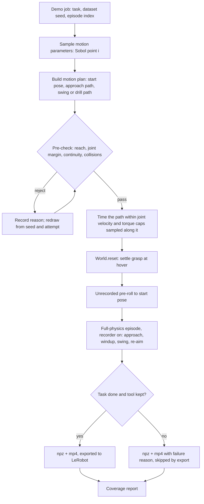

# feat: Planned motion variation for the VLA's hammer and drill demos

## Summary

Replace the single straight-down scripted motion in the VLA demo generator with a sampled family of planned motions.
Each episode draws a start pose away from the task, an approach path, and a swing (or drill approach) shape and
timing from a declared parameter space. The motion is timed so the whole path stays inside the arm's joint velocity
and torque limits, pre-checked for reach and collisions, and then run in the existing full-physics testbed, where
only successes are exported. The existing scripted motion stays the default, reproduced exactly, and a closed-loop
evaluation from misaligned starts measures whether the new data teaches the VLA to find and strike the target.

---

## Problem Frame

The VLA (the slow layer) has to learn the large motion: where to go, where to swing, when and how fast. The fast RL
residual handles force reactions and needs no demos. Teleoperating hundreds of dynamic hammer swings through a
dexterous hand is too slow and too hard, so the demos are generated in simulation (`tactile_sim/vla/demos.py`).

Those demos are physically valid but kinematically narrow:

- **Every episode starts lined up over the target.** The strike geometry is built outward from the hover pose
  (`strike_geometry` in `tactile_sim/model/builder.py`). `demo_config` moves the hover and the task together
  (`TASK_SHIFT`), and `World.reset_pose` starts the arm at the hover. No demo shows a reach or an aim, so a VLA can
  score well while ignoring where the nail is. The closed-loop evaluation (`tactile_sim/experiments/vla_experiment.py`)
  builds its episodes with the same `demo_config`, so it cannot catch this.
- **Every swing is the same shape.** `ScriptedSwing` (`tactile_sim/behaviors/swing.py`) drives one fixed 1-D path,
  a line or an arc (`StrikeGeometry`), with a min-jerk approach that only projects the current pose onto that path.
  Variation is limited to strike speed (±15 %), physics, the ±3 cm shift and visuals. The drill
  (`PositionDrillFeed` in `tactile_sim/behaviors/tool_tasks.py`) approaches the same way, straight along the bit
  axis from a fixed pre-contact pose.
- **The speed and acceleration caps hold only at the hover pose** (`ScriptedSwing._arm_caps`). That is fine for one
  fixed path but not for paths that leave it.

The documented closed-loop failures (GR00T dropping the hammer before the first strike, `docs/vla_in_sim.md`) also
point at a lack of off-nominal states in the data.

---

## Requirements

**Motion variation**

- R1. Hammer and drill demos start from sampled poses away from the pre-strike or pre-contact pose. The default region
  is about ±10 cm in position and ±15° in orientation, and is configurable. The demo records the approach from there.
- R2. Hammer swings vary in shape and timing: windup apex position and direction, the terminal stroke (line, or arc
  radius), windup and settle durations, and strike speed. Every blow still meets the nail square, along the strike
  axis.
- R3. Drill approaches vary in start pose, approach path, approach angle and speed. They end aligned on the screw
  axis at the pre-contact pose, after which press, drive, release and retract are unchanged.

**Physical validity**

- R4. Every planned motion respects the arm's joint velocity and torque limits along its whole path, not only at
  the hover pose.
- R5. Candidate motions are pre-checked before simulation for reach, joint-range margin and collisions with the
  table, workpiece and robot body. Rejected candidates are resampled, and the rejection reasons are recorded.
- R6. Episodes run in full physics as today, and only successes are exported by default. Failed episodes keep their
  parameters and failure reason.

**Compatibility and reproducibility**

- R7. With variation off (the default), the hammer and drill bases reproduce today's episodes exactly. The residual's
  base library (`tactile_sim/behaviors/base_library.py`) and the v5 demo settings depend on this.
- R8. Generated demos use the existing recorder, the 27-D state and action layout, the per-task hand tables and the
  LeRobot export. Datasets from both generators can be exported and mixed.
- R9. Each episode's motion parameters are deterministic from its job (dataset seed and episode index) and are
  recorded in its metadata.

**Measurement**

- R10. A coverage report summarizes the parameter distributions, the pre-check rejection rates and reasons, and sim
  success broken down by parameter region.
- R11. The closed-loop VLA evaluation can start episodes from varied (misaligned) poses drawn by the same start-pose
  sampler, so models trained on v5 and on the new data compare on both aligned and misaligned starts.

---

## Scope Boundaries

- Hammer and drill (screw driving) only.
- Motion of the arm only. The hand's grip stays the existing open-loop hold and the per-task hand tables are
  unchanged.
- The contact pose (tool orientation at contact, the wrap) is not varied. Changing it would move the hover pose,
  re-run grasp synthesis per episode and break residual parity (see KTD-3).

### Deferred to Follow-Up Work

- **A second, distinct swing family** (a side swing, a two-stage windup), once the coverage report shows the first
  family works.
- **Biasing the sampler toward success** with a cross-entropy or other adaptive scheme, if rejection or failure rates
  turn out high in some regions.
- **MimicGen-style seed-demo transforms**, for teleop or human-motion seeds (`tactile_sim/replay/`).
- **Language tags per swing family,** if the evaluation shows strategy confusion.
- **Drilling holes, the saw, picking the tool up, and regrasping.**
- **A recorder that also runs on the real robot,** and real-sensor versions of the scripts' sim-truth inputs.
- **The 30 Hz action-rate decision.**
- **GR00T's training-time image augmentation switch** (`tactile_sim/vla/finetune/gr00t_finetune.py`).

---

## Key Technical Decisions

- KTD-1. **Sample from a parametric motion family, time it within limits, pre-check it, then simulate and filter.**
  The landscape scan ranked this first for this setting. It extends the existing script, keeps the physics filter and
  export, and gives deliberate, controllable variation in shape, direction and timing.
  - **Rejected:** trajectory optimization per episode (cost, little added diversity), RL-generated demos (a separate
    project), and DMP or ProMP templates (they only vary near the template).
  - **Deferred:** MimicGen-style transforms, which need seed demos the project does not have yet.
- KTD-2. **Keep the existing split between path shape and timing.** `StrikeGeometry` maps a path parameter `s`
  (distance travelled by the face) to a pose. `StrikePath` drives `s` with 1-D time segments, and
  `ReferenceSpreader`, the residual's lookahead (`SwingBase._update_arm_lookahead`) and the re-aim all consume that
  interface (`pose`, `tangent`, `s_of`, `shifted`, `evaluate`).
  - A new composite geometry implements the same interface: a free 3-D spline from the windup apex, blending with
    continuous tangent into the existing terminal line or arc that ends at the contact pose.
  - Downstream consumers then need no changes, and the contact stays square by construction.
- KTD-3. **Hold the contact pose and the hover pose fixed. Vary everything before the contact.**
  - The hover pose, `World.q_hover`, the grasp keyframe cache key and the residual's training scene all derive from
    `SimConfig`.
  - Per-episode motion parameters therefore live in a separate motion-plan object handed to the base, not in
    `SimConfig`. Prewarming, grasp synthesis and the base library stay untouched.
- KTD-4. **Reach the sampled start pose with an unrecorded pre-roll.** `World.reset` settles the grasp at the hover
  pose as today. A short joint-space min-jerk move then takes the arm to the sampled start pose before recording
  begins, and the recorded demo starts there.
  - This keeps grasp settling and its validation unchanged.
  - Rejected: settling the grasp at arbitrary poses, which is new physics risk at every start.
- KTD-5. **Time the whole path in-house against limits sampled along it,** generalizing `ScriptedSwing._arm_caps`.
  - At sampled path points: joint rates per unit path speed from the Jacobian pseudo-inverse, and joint torques per
    unit path acceleration from the effective mass matrix with the tool's payload.
  - Fit the existing quintic strike and brake profiles under the tightest cap, slowing down until feasible as
    `_start_swing` already does.
  - No new dependency. The scan found `toppra` and `ruckig` may need source builds on Windows. A true time-optimal
    parameterization (TOPP-RA) stays a deferred option if the simple fit proves too conservative.
- KTD-6. **Pre-check kinematics and collisions without new libraries.** Run the existing damped-least-squares IK
  (`World.ik` and `solve_ik`) at sampled path points on a scratch `MjData`. Check the residual, joint-range margin and
  joint-space continuity (no branch flips; the replay work hit a wrist flip on the Vega). Run MuJoCo's collision
  detection for contacts between the arm, hand or tool and the table, workpiece or robot body, excluding the intended
  hand–tool and planned tool–target contacts. Rejected: `mink`, OMPL, cuRobo. The repo's IK suffices, and cuRobo is
  GPU-only.
- KTD-7. **Sample parameters with a scrambled Sobol sequence indexed by episode.** Use `scipy.stats.qmc`; SciPy is
  already a dependency and 1.14 is installed. The dataset seed fixes the sequence, and episode *i* takes point *i*, so
  coverage is even across a run and every episode is reproducible on its own. A rejected candidate is redrawn from a
  per-episode generator seeded by (seed, index, attempt), up to a retry budget, and every attempt's reason is kept.
- KTD-8. **Each episode is internally consistent.** It uses one sampled family member, with only small per-strike
  jitter in the windup apex and timing; strategies are not mixed within a swing. The scan found no direct study of
  multi-strategy scripted data for VLAs and flagged multimodality as a plausible risk. GR00T's and π0.5's
  flow/diffusion action heads handle multimodal actions, and consistent episodes keep each strategy learnable from
  context. Language tags are deferred until the evaluation shows a need.
- KTD-9. **Opt-in at every layer, with characterization first.** New config fields default to today's behavior.
  `demos.py` gains a generator choice (`scripted` | `planned`). A golden-trace test of the default hammer and drill
  bases is written before any change to `swing.py` or `tool_tasks.py`.
- KTD-10. **The evaluation shares the start-pose sampler.** `vla_experiment` gains a start condition (`aligned` |
  `varied`). Varied episodes draw their start pose from the same sampler on the evaluation seeds, which are already
  disjoint from the demo seeds, and pre-roll to it the same way. A dataset is judged by closed-loop success from both
  kinds of start, not by its episode count.

---

## High-Level Technical Design

### Generation pipeline (per episode)

### Hammer episode phases with planned motion

```mermaid
stateDiagram-v2
  [*] --> preroll: grasp settled at hover
  preroll --> approach: start pose reached; recorder starts
  approach --> windup: at hover pose
  windup --> swing: at sampled windup apex
  swing --> post: impact flag or timeout
  post --> settle
  settle --> windup: nail not home; next apex jittered
  settle --> [*]: nail home or strike budget used
```

With variation off, `preroll` is skipped, `approach` is today's min-jerk projection, and the windup and swing follow
`world.geom` exactly as now. The drill's equivalent is preroll → planned approach → aligned pre-contact pose →
press → drive → release → retract, with the last four unchanged.

### Motion parameter space

This is directional; U4 fixes the exact ranges after a pilot run.

| Group | Parameter | Hammer | Drill |
|---|---|---|---|
| Start | position offset from the pre-strike or pre-contact pose | box, about ±10 cm, held above the table | same |
| Start | orientation tilt | about ±15° | about ±15° |
| Approach | via-point lateral bias, duration | yes | yes, plus approach angle into the final aligned stretch |
| Swing | windup apex: height, back and side offset | yes | — |
| Swing | terminal stroke: line, or arc radius | line or arc, about 0.4–0.8 m | — |
| Timing | windup, settle durations; strike speed as a fraction of the path cap | yes | approach speed |
| Per strike | apex and timing jitter | small | — |

---

## Implementation Units

### U1. Composite strike path

**Goal:** A path geometry that starts anywhere (the windup apex), follows a smooth 3-D spline, and blends with a
continuous tangent into the existing terminal line or arc ending square at the contact. It is drop-in compatible
with `StrikeGeometry`.

**Requirements:** R2, R4 (prerequisite), R7

**Dependencies:** none

**Files:**
- Modify: `tactile_sim/behaviors/trajectories.py`
- Create: `tests/test_strike_paths.py`

**Approach:**
- **Interface.** Implement `pose(s)`, `tangent(s)`, `s_of(x)`, `shifted(dx)`, `s_c0` and `L` so `StrikePath`,
  `ReferenceSpreader`, the re-aim and the residual's lookahead accept it unchanged.
- **Arc-length parameterization.** Parameterize the spline by face distance, using a precomputed arc-length table
  that is inverted numerically.
- **Orientation.** Interpolate from the apex orientation to the terminal stroke's starting orientation with slerp.
- **Nearest point.** `s_of` finds the nearest point with a coarse table lookup plus local refinement.
- **Overshoot.** Past the contact, the path continues along the terminal stroke's extension, as today, for
  reference spreading's overshoot.

**Patterns to follow:**
- `StrikeGeometry` and `StrikePath` in `tactile_sim/behaviors/trajectories.py`.
- `_rot` for rotations.
- `tests/test_swing.py::test_quintic_boundary_conditions` for numeric boundary tests.

**Test scenarios:**
- **Square contact:** at `s = s_c0` the pose equals the terminal stroke's contact pose (position and rotation), for
  both line and arc terminals.
- **Continuity:** position and tangent are continuous across the spline-to-terminal junction, with an error below
  1e-6 at the knot.
- **Arc-length scale:** the numerical derivative of the pose with respect to `s` has unit length along the spline.
- **`s_of` round trip:** `s_of(pose(s)) ≈ s` across the whole range.
- **Offset points:** `s_of` on a point 5 mm off the path returns the nearest parameter.
- **`shifted`:** translates every pose by `dx` and leaves rotations unchanged.
- **Degenerate case:** with the apex exactly on the terminal stroke's backward extension, the composite reproduces
  `StrikeGeometry`'s poses within tolerance.
- **Bad input:** an apex whose spline would pass the contact before the junction is rejected with a clear error.

**Verification:** the new geometry is driven through a `StrikePath` with quintic segments, and `evaluate()` returns
smooth pose, velocity and acceleration with the contact square.

---

### U2. Limit-aware timing and pre-sim feasibility check

**Goal:**
- Speed and acceleration caps sampled along any path. A quintic strike profile fitted under the tightest one.
- A kinematic and collision pre-check that rejects bad candidates before the 3-minute simulation.

**Requirements:** R4, R5

**Dependencies:** U1

**Files:**
- Create: `tactile_sim/behaviors/feasibility.py`
- Modify: `tactile_sim/sim/world.py`. Give `payload_mass_matrix` and `tcp_pose` an optional `data` argument,
  defaulting to `self.data`, as `ctrl_pose` and `ctrl_jacobian` already have. Without it, caps evaluated on a
  scratch `MjData` carry the tool inertia of the live arm pose.
- Create: `tests/test_feasibility.py`

**Approach:**
- **Path caps.** Generalize `ScriptedSwing._arm_caps` to path samples:
  - Joint rates per unit `s`-speed come from `pinv(J) · [tangent; angular rate]`.
  - Joint torques per unit `s`-acceleration come from `M_eff · dq`, using `World.payload_mass_matrix` and
    `hammer_payload`.
  - The result is `v_cap(s)` and `a_cap(s)`, with the same margins as today (`SwingCfg.v_margin`, 60 % torque).
- **Profile fit.** Fit the existing `strike_profile` and `brake_profile` under `min_s` caps, then sample the timed
  profile and confirm no cap is exceeded anywhere. If one is, lower the speed and retry, mirroring
  `_start_swing`'s 0.97 loop.
- **Pre-check.**
  - Run IK at N path points, seeded from the previous point, on a scratch `MjData`.
  - **Carry the tool with the hand.** The tool sits on a free joint, so setting the arm's qpos does not move it. At each
    sample, write the tool's free-joint qpos from the hand body's pose times the live hand-to-tool relative pose (the
    pattern in `World.reset_pose`), then call `mj_forward` before checking collisions.
  - Reject on any of: an IK residual above tolerance, joint-range margin below a threshold, a joint-space jump
    between neighbouring points above a threshold (a branch flip), or a collision. Count as a collision any contact
    between robot or tool geoms and the table, workpiece or robot body, except the hand–tool contacts and the planned
    face–nail or bit–screw contact.
- **Return value.** A structured verdict: pass/fail, the reason code, and the worst ratios.

**Patterns to follow:**
- `ScriptedSwing._arm_caps` and `_start_swing` in `tactile_sim/behaviors/swing.py`.
- `World.ik` and `solve_ik` in `tactile_sim/sim/world.py`.
- `tactile_sim/limits.py` for limit ratios and naming.

**Test scenarios:**
- **Matches today's caps:** for today's `world.geom` (line, and the Vega's arc), the caps at `s = 0` equal
  `ScriptedSwing._arm_caps` within 1e-6.
- **Feasible fit:** a fitted profile on a composite path never exceeds `v_cap(s)` or `a_cap(s)` at any sampled time,
  and arrives at contact at the planned speed or a lowered one.
- **Out of reach:** a start pose 0.5 m outside the workspace is rejected as unreachable.
- **Joint range:** a path that drives joint 7 to its range limit is rejected for joint margin.
- **Collision:** a path whose windup apex sits inside the table is rejected as a collision.
- **Branch flip:** a path through the wrist singularity is rejected as discontinuous.
- **Today's swing passes:** the nominal swing is accepted with all ratios below 1.
- **Pure check:** the pre-check never mutates the live `World.data`; qpos and time are unchanged afterwards.

**Verification:** the pre-check accepts today's demos' geometry and rejects the four constructed bad cases, each
with its reason code.

---

### U3. Bases that take a motion plan, with defaults unchanged

**Goal:**
- `ScriptedSwing` and `PositionDrillFeed` accept an optional motion plan: start pose, approach path, per-strike
  windup apex and terminal stroke, and timings.
- With no plan they behave exactly as today.

**Requirements:** R1, R2, R3, R7

**Dependencies:** U1, U2

**Files:**
- Modify: `tactile_sim/behaviors/swing.py`
- Modify: `tactile_sim/behaviors/tool_tasks.py`
- Modify: `tactile_sim/behaviors/base_sources.py`, only if the lookahead or forecast needs the plan's paths
- Modify: `tactile_sim/config.py` (a `MotionPlan`-style dataclass outside `SimConfig`, per KTD-3)
- Create: `tests/test_motion_plan_bases.py`
- Test: `tests/test_swing.py`, `tests/test_base_library.py`, `tests/test_vla.py` (existing, must pass unchanged)

**Execution note:** Characterization first. Before touching the bases, add golden-trace tests that record a short
default hammer episode and a default drill episode on the CPU testbed: the arm's `q_ref` stream, strike times, and
nail depth or screw state. Keep them passing bit for bit throughout.

**Approach:**
- **Hammer approach.** `ScriptedSwing.reset` with a plan builds a planned approach: a 3-D min-jerk or spline path
  from the current pose to the hover pose, with orientation slerp. It replaces today's projection onto the strike
  path.
- **Hammer windup and swing.**
  - `_start_windup` targets the plan's apex for this strike.
  - `_start_swing` builds the U1 composite path from the apex and times it with U2's fit, replacing the `_arm_caps`
    at-hover caps for planned swings.
  - Re-aim (`_geom().shifted`, the drift learning) and reference spreading keep working through the shared interface.
- **Drill.** `PositionDrillFeed.reset` and `target` follow a planned approach that ends on the existing aligned
  pre-contact pose `x0` (after `aim_from_tool`), entering along the bit axis for its last stretch. The press, drive,
  release and retract phases are untouched.
- **Phase names.** Expose the current phase, with a new `approach` meaning for the planned case, so the demo
  recorder and perturbations can key on it.

**Patterns to follow:**
- The existing phase machine in `ScriptedSwing.tick`.
- The `target(t)` lookahead contract in `PositionDrillFeed`.
- `DrillCfg.aim_from_tool`, an opt-in behavior flag with a default-off path.

**Test scenarios:**
- **Default hammer unchanged:** the golden `q_ref` stream, strike times and depth are identical.
- **Default drill unchanged:** the golden trace is identical (screw seated at the same time).
- **Hammer from an offset:** a plan with a start 8 cm lateral reaches the hover pose within 2 mm before the first
  windup, and the first blow lands on the nail head (face centre within the head radius).
- **Varied swings:** with plans of different apex heights and arc radii, every blow arrives along the strike axis
  (face velocity direction within 3° of the axis at contact) and below the planned speed cap.
- **Drill from an angle:** a plan approaching 20° off the bit axis is aligned within 1° and 1 mm at the pre-contact
  pose, then seats the screw.
- **Per-strike jitter:** within one episode, successive windup apexes differ by the jitter amount and stay inside
  the family.
- **Lookahead still works:** the residual's lookahead returns finite joint offsets on a planned swing.
- **Residual library unaffected:** a base-library entry recorded with no plan replays as before
  (`tests/test_base_library.py` unchanged and passing).

**Verification:** the default-off golden traces are bit-identical, and planned hammer and drill episodes complete
the task in the testbed from offset starts.

---

### U4. Motion-variation sampler

**Goal:** A declared parameter space per task, and a sampler that turns (dataset seed, episode index) into a
pre-checked motion plan, or a recorded list of rejections.

**Requirements:** R1, R2, R3, R5, R9

**Dependencies:** U1, U2, U3

**Files:**
- Create: `tactile_sim/vla/variation.py`
- Create: `tests/test_vla_variation.py`

**Approach:**
- **Parameter spaces.** One frozen dataclass per task. Each declares its parameters with ranges and units, with
  defaults from the HTD table; U4 tunes them on a pilot.
- **Sampling.** A scrambled Sobol sequence (`scipy.stats.qmc.Sobol`) seeded by the dataset seed; episode *i* takes
  point *i*, mapped to the ranges. Retries draw from `default_rng((seed, index, attempt))`.
- **Pre-check.** Each candidate is built into a motion plan and pre-checked with U2 against a scratch copy of the
  episode's world, after `demo_config`'s physics draw, since the head mass changes the torque caps.
- **Retry budget.** Up to a fixed number of attempts (default 20). Exhausting it marks the episode `rejected`.
- **Start-pose sampler.** Exposed separately, so the evaluation (U6) draws starts without swing parameters.

**Patterns to follow:**
- `demo_config` in `tactile_sim/vla/demos.py`, which seeds per-episode randomness from the job seed.
- `residual_dr` in `tactile_sim/sim/randomize.py`, which returns plain-dict draws that serialize into metadata.

**Test scenarios:**
- **Deterministic:** the same (seed, index) gives the same plan and attempt history across two calls and two
  processes.
- **Distinct:** different indices give different start poses; 64 consecutive Sobol points cover each position axis's
  range with no empty eighth.
- **Retries:** a forced pre-check failure on the first two attempts gives the third attempt's plan, with two
  recorded reasons.
- **Budget exhausted:** every attempt rejected returns `rejected` with all reasons and no exception.
- **Start sampler on its own:** it returns poses inside the configured box and tilt, above the table.
- **Serializable:** a plan's parameter dict JSON-serializes and rebuilds the same plan.

**Verification:** sampling 200 hammer and 200 drill plans offline (no physics) gives the acceptance rate and reason
histogram. Both tasks accept a majority of candidates; the exact threshold is tuned during the pilot.

---

### U5. Demo pipeline integration

**Goal:** `vla.demos` can generate planned-variation episodes end to end: pre-roll, record from the start pose,
recovery pushes in the new approach, metadata, and export.

**Requirements:** R1, R6, R8, R9

**Dependencies:** U3, U4

**Files:**
- Modify: `tactile_sim/vla/demos.py`
- Modify: `tactile_sim/vla/lerobot_export.py`
- Test: `tests/test_vla.py`

**Approach:**
- **Job options.** `DemoJob` gains a `generator` field (`scripted` | `planned`, default `scripted`) and a dataset
  seed. The CLI gains matching flags.
- **Episode flow.**
  1. `run_demo` gets the plan from U4.
  2. After `World.reset`, a joint-space min-jerk pre-roll moves the arm to the start pose with the recorder gated
     off.
  3. The base starts with the plan, and the recorder opens on the base's ready signal instead of only `START`.
- **Rejected episodes.** These write a metadata-only `.npz` (no video) so the coverage report counts them.
- **Recovery pushes.** `DemoPerturbation` gains push windows in the planned approach and the first windup, the
  phases where the GR00T models dropped the hammer, and keeps the existing ones.
- **Metadata.** Adds `generator`, the plan's parameters, the attempts with reasons, and the start pose.
- **Export.** `lerobot_export` copies `generator` into `episodes.jsonl`, skips `rejected` and failed episodes as
  now, and accepts directories from both generators in one export.

**Patterns to follow:**
- `run_demo`'s `.part` rename discipline.
- `DemoPerturbation._window_now`.
- How `meta` already carries `draw`, `visual` and `pushes`.

**Test scenarios:**
- **Planned episode recorded:** a short planned hammer episode (fast physics, a few strikes) writes `npz` and `mp4`
  whose first recorded state is at the sampled start pose (within 1 cm), not at the hover.
- **No pre-roll frames:** the frame count and timestamps start after the pre-roll.
- **Push windows:** with `perturb = 1` and a planned plan, at least one push falls in the approach or first windup,
  and the recorded action stays the base's target.
- **Rejected job:** writes a metadata-only file, and export skips it without error.
- **Mixed export:** directories from both generators export into one dataset whose `episodes.jsonl` shows both
  `generator` values. The hand tables and tools still match per task.
- **Default unchanged:** a `scripted` job's `npz` matches today's `test_a_demo_records_the_vla_view_state_and_action`
  expectations.

**Verification:** a 20-episode planned pilot per task runs end to end and exports. Its videos show reaches from
varied starts and varied swings.

---

### U6. Coverage report and misaligned-start evaluation

**Goal:** Measure what the generator produced, and test models from misaligned starts.

**Requirements:** R10, R11

**Dependencies:** U4, U5

**Files:**
- Create: `tactile_sim/vla/coverage.py`
- Modify: `tactile_sim/experiments/vla_experiment.py`
- Modify: `tactile_sim/vla/client.py`. `run_vla_episode` builds the testbed and runs the whole step loop, so it takes
  an optional start pose and runs the pre-roll before constructing `VlaBase`. Otherwise `VlaBase.reset` captures the
  hover as `q_arm0` and its frame clock starts during the pre-roll.
- Test: `tests/test_vla_experiment.py`, `tests/test_vla_variation.py`

**Approach:**
- **Coverage report.** A CLI over demo directories that prints, per task:
  - parameter histograms;
  - acceptance and rejection reasons;
  - sim success by parameter bin (start offset magnitude, arc radius, apex height);
  - success rate overall and against v5-style aligned starts.

  Plain-text tables, in the same style as `vla_experiment report`.
- **Misaligned-start evaluation.** `vla_experiment` gains `--starts aligned|varied` (default `aligned`). Varied
  episodes draw a start pose from U4's start sampler on the evaluation seed and pre-roll to it before the VLA's first
  chunk. The condition is recorded in each episode's JSON, and the report pairs seeds within a condition as today.

**Patterns to follow:**
- `vla_experiment`'s `Condition`, `report` and `paired_bootstrap`.
- `residual_experiment`'s report tables.

**Test scenarios:**
- **Report counts:** three fake episode metas (success, failure, rejected) give the right counts and reasons.
- **Varied starts:** `--starts varied` episodes begin at sampled poses, the same pose for the same seed across runs,
  and aligned episodes are unchanged.
- **Replay from a varied start:** a `ReplayPolicy` run of a planned demo under `varied` starts at that demo's own
  start pose. Its seed and start sampler are shared, so the replay completes the task: an end-to-end check that the
  pre-roll and recorder agree.

**Verification:** the report runs on the U5 pilot directories. A replayed planned demo completes the task through
the client from its varied start.

---

### U7. Documentation

**Goal:** Record the generator, its parameters and the dataset-version history.

**Requirements:** R8, R10, R11

**Dependencies:** U5, U6

**Files:**
- Modify: `docs/vla_in_sim.md`

**Approach:**
- Add a "Planned motion variation" section: what is varied, the commands for a v6 run, the coverage report, and
  the misaligned-start evaluation.
- Add a dataset-version list that notes v4 and v5 exist in code (`e4e483c`), with their generation and results
  still to be recorded from the desktop and Skynet runs.

**Test expectation:** none (documentation only).

**Verification:** the doc's commands match the CLI flags added in U5 and U6.

---

## Implementation Notes (2026-10-31)

Where the build departed from the units above, and why:

- **Module layout.**
  - The composite path and the transit live in a new `tactile_sim/behaviors/strike_paths.py`; `trajectories.py` is
    untouched.
  - The plans and the pre-roll live in `tactile_sim/behaviors/motion_plan.py`.
  - The golden traces are `tests/data/golden_bases.json`, made by `tests/data/make_golden_bases.py`. They are compared
    bit for bit on the recording machine and to 1e-9 elsewhere, with a stored fingerprint.
- **Path parameterization.** The composite keeps the stroke's `s` (face distance). On the arc the TCP moves
  k ≈ 0.69 per unit `s`, and the first version, parameterized by TCP distance, made speed jump at the junction. The
  geometry exposes `straight = False`; ScriptedSwing branches on `is_straight()`, never on `L`.
- **Bases built at hover, then started.** `ScriptedSwing.begin(t, plan)` and `PositionDrillFeed.begin(t, plan)` start
  a planned episode after `preroll()`, which suspends the L2 tick and drives a joint stream. The plan lives on the base
  as `motion`, since `plan` is ScriptedSwing's per-strike StrikePlan. `Episode.run` sizes its time budget from the
  swing's own durations.
- **Clearance.**
  - `mj_geomDistance` reported zero for mesh pairs 10–30 cm apart on this scene (MuJoCo 3.11).
  - `ArmProbe` instead runs MuJoCo's collision pipeline on a private model copy, in which only
    moving-vs-obstacle pairs collide, with a 1 cm margin; pairs in contact at the hover pose are ignored.
  - The probe's IK caps each step at 0.1 rad. Unbounded steps diverged on large reorientations.
- **Strike speed.**
  - The swing's single braking quintic cannot stretch over strokes much longer than the scripted one at the Vega's
    speed cap (about 0.225 m). Past that it falls back to a 0.2 m/s crawl.
  - The sampler biases the apex toward shorter windups (−6 to +1 cm back).
  - The pre-check rejects plans whose blow would land below 90 % of the scripted stroke's speed (`slow_strike`).
  - The swing's speed caps are evaluated along the windup curve and combined with the configured hover caps; the
    terminal stroke is the configured one.
- **Start space, narrowed after the first sampling runs.** About ±8 cm across, 0–8 cm above, ±8° tilt. Below the
  hover pose the hammer head nears the board, and joint 7 sits 0.33 rad from its limit at hover.
- **Out of the build.** Per-strike apex jitter: each episode uses one windup curve.

---

## Open Questions

### Deferred to Implementation

- **Collision geometry for the pre-check (U2).** Which robot-link, table and workpiece geoms have collision enabled
  in the Vega scene, and whether the body needs extra collision primitives so arm–table and arm–torso contacts are
  detectable. Read from the compiled model during U2.
- **Can the pre-roll disturb the settled grasp (U5)?** Measure tool slip during the pre-roll. If it is not
  negligible, move more slowly, or reject episodes whose tool moved more than a threshold before recording.
- **PositionL1's null-space pull toward the hover posture** may bias large start offsets toward one IK branch. Check
  this when the first planned approaches run (U3); seeding from the plan's own IK solutions is the fallback.
- **The recorder's start signal (U5).** A flag on the base, or a gate on the scheduler; whichever keeps the scripted
  path's first frame unchanged.
- **Exact parameter ranges and the retry budget (U4).** Set from the pilot's coverage report.

---

## System-Wide Impact

- **The RL residual's base library** records `SwingBase` episodes and must stay bit-identical (R7, U3's golden
  traces, `tests/test_base_library.py`). A later choice to train the residual on planned swings is a separate
  decision; the library would need re-recording and the GPU parity checks re-run.
- **Compute cost.** Planned episodes are longer (approach plus pre-roll) and fail more often than today's
  ~97 %-successful hammer demos, so more CPU time per exported episode. The pre-check (U2) exists to keep that
  overhead low; the coverage report makes it visible.
- **Evaluation comparability.** Results under `--starts varied` are a new condition and are not comparable with
  earlier E2 numbers. Reports must label the condition.

---

## Risks

| Risk | Mitigation |
|---|---|
| Wide sampling yields low sim success, mostly drops or misses, wasting compute | U2 pre-check, U6 success-by-region report, narrowing ranges after the pilot; adaptive sampling deferred |
| The wrap was tuned for the current strike direction and loads differently on new swing directions, so drops rise | The physics filter excludes drops; the report flags regions with high drop rates for narrowing |
| Diverse strategies make the VLA's action distribution harder to learn (multimodality) | One family member per episode (KTD-8); compare v5 and v6 models on aligned starts; language tags deferred |
| A golden-trace break goes unnoticed and shifts residual results | Characterization tests first (U3), default-off flags (KTD-9) |
| IK branch flips or wrist singularities on large start offsets | U2 continuity check; IK seeded from neighbouring path points |
| 30 Hz recording of faster or more varied motions loses detail | Unchanged from today; the action-rate decision is deferred and the report records strike speeds |

---

## Success Metrics

- **The pilot (U5) runs end to end for both tasks.** Starting targets, to tune: a majority of candidates pass the
  pre-check, and at least 80 % of accepted hammer episodes succeed. Drill seating stays near today's v3 rate.
- **Measured coverage.** Start offsets span the configured box, and arc radii and apex heights span their ranges.
- **The decisive comparison.** A VLA trained on the new data at least matches the v5-trained one from aligned
  starts, and does better from varied starts.

---

## Sources & Research

- **Codebase:**
  - `tactile_sim/behaviors/swing.py`: `ScriptedSwing`, `_arm_caps`, `_start_swing`, re-aim.
  - `tactile_sim/behaviors/trajectories.py`: `StrikeGeometry`, `StrikePath`, `strike_profile`, `brake_profile`.
  - `tactile_sim/behaviors/tool_tasks.py`: `PositionDrillFeed`, `aim_from_tool`.
  - `tactile_sim/behaviors/base_sources.py`: `SwingBase` lookahead.
  - `tactile_sim/sim/world.py`: `reset_pose`, `settle`, `ik`.
  - `tactile_sim/model/builder.py`: `strike_geometry`, the contact pose built from the hover.
  - `tactile_sim/vla/demos.py`: `demo_config`, `DemoPerturbation`, `run_demo`.
  - `tactile_sim/experiments/vla_experiment.py`: the evaluation reuses `demo_config`.
- **Prior art:**
  - SkillMimicGen (arXiv 2410.18907): skill segments plus motion-planned transit; the transit-diversity idea behind
    the planned approach.
  - DexMimicGen (arXiv 2410.24185): dexterous bimanual demo generation in online sim with success filtering.
  - MimicGen (CoRL 2023).
  - Diffusion-RL data for VLAs (arXiv 2509.19752): RL-generated data needed many parallel environments to avoid mode
    collapse. Supports keeping RL demo generation out of scope.
- **Hammering:**
  - Optimal-control tool affordance for impact tasks (arXiv 2402.05502): head speed at contact as the objective.
  - HMAMP (arXiv 2510.24257): humans wind up backward to build energy; supports varying the windup apex.
  - Adaptive IK for variable-length tools (arXiv 2510.26551): earlier sim work hard-coded the hammering trajectory.
- **Libraries considered:**
  - `toppra` 0.6.10 (MIT) and `ruckig` 0.19.4 (MIT): possible Windows source builds.
  - `mink` 1.3.0 (Apache-2.0).
  - Pinocchio (no pip on Windows).
  - cuRobo (GPU only).

  None are adopted (KTD-5, KTD-6).
- **Not verified by the scan:**
  - no published work on automated diverse-swing generation for a humanoid hand with a hammer or drill;
  - "Demonstration Diversity Is Not Free" (NeurIPS 2026), seen only as an abstract.
