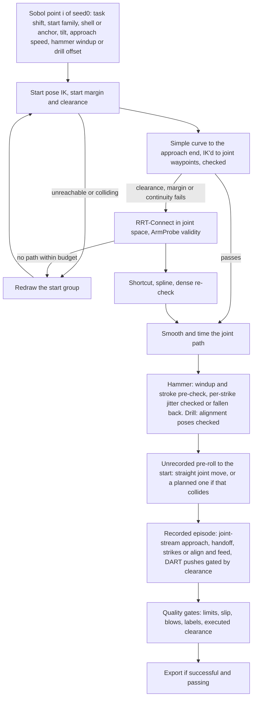
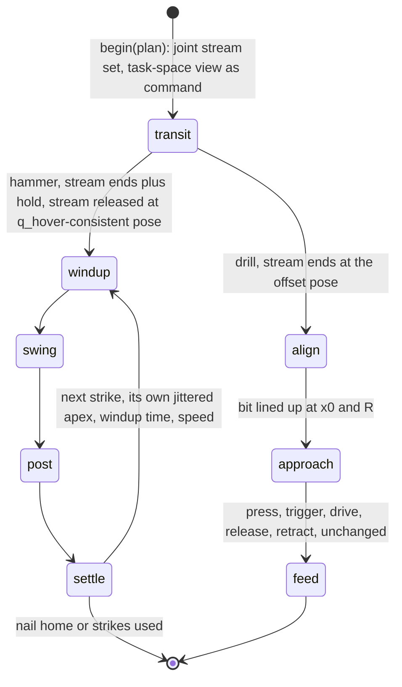

# feat: Far starts with a joint-space planner, per-strike variation and an angled drill entry for the planned VLA demos

## Summary

Widen the planned demo generator from centimetre-scale variation to starts up to 40 cm away, from any side and from
tucked or resting arm postures. Reach the task along joint-space paths that a planner finds around the table, board
and robot body when a simple curve would collide. Give every hammer strike its own windup, and bring the drill in
tilted and offset so it visibly lines up before the feed. A new post-simulation clearance gate checks every recorded
motion, and DART recovery pushes become the default for planned demos.

---

## Problem Frame

The planned generator (`docs/plans/2026-10-29-001-feat-vla-demo-motion-variation-plan.md`) made the VLA demos vary,
but only a little:

- **Starts are close.** The start box is ±8 cm sideways and 0–8 cm above the hover pose, with ±8° of tilt. No demo
  shows the arm reaching the task from where a real arm would be when a task begins.
- **There is no planner.** The approach is one quadratic Bezier with a sideways bulge (`TransitPath`). It is
  pre-checked and discarded when it fails. Near starts never meet an obstacle, so this has not mattered. Far starts
  would: a simple curve from beside or below the task often passes through the table, the board or the robot's body.
  The pre-check would reject those starts and redraw them, and the dataset would quietly drift back to the easy
  starts.
- **Every strike in an episode is identical.** The prior plan (its KTD-8) called for small per-strike jitter in the
  windup apex and timing. It was not implemented: every strike reuses the plan's single apex and windup time.
- **The checked path is not quite the executed path.** The pre-check validates its own IK solutions. `PositionL1`
  then tracks the approach in task space with its own differential IK and a weak null-space pull to the hover posture,
  so the elbow can take a route the pre-check never saw. The robot's geoms have collisions disabled in the scene
  (`tactile_sim/model/robots.py`), so physics would not catch that either.
- **The drill always comes in square.** Its transit ends at the pre-contact pose already aimed. No demo shows the bit
  being lined up with the screw, which is the drill's core visual skill.

The end goal is a VLA that does the large motion (where to go, where to swing, when, how fast) closed-loop, while the
tactile residual handles forces. Variation earns its place here when it forces the model to use what it sees, covers
states the model will actually reach, or matches what the real robot faces. Variation that only adds style (angled
blows, other swing styles, path wobble) was considered and deferred; see Scope Boundaries.

---

## Requirements

**Far starts and planning**

- R1. Hammer and drill episodes can start anywhere from at the task to 40 cm from the hover or pre-contact pose: from
  above, from the sides, and from below the hover height where the arm and tool clear the table, with tilt up to ±20°
  per axis. A share of episodes starts from tucked or resting arm postures.
- R2. When the simple curve to the task fails the pre-check on clearance, joint margin or IK continuity, a joint-space
  planner searches for a collision-free path instead of redrawing the start. A start is rejected only when the planner
  fails within its budget, or the start pose itself is unreachable or colliding.
- R3. Approach paths, whether curve or planner, are smooth enough to pass `vla.quality`'s label gates (target rate and
  alternation). They are timed so that no joint's target exceeds `SPEED_MARGIN` of its velocity limit. The approach
  speed varies per episode.
- R4. The executed approach follows the checked joint path. The bases take over at the end of the approach without a
  step in the commanded reference.
- R5. The unrecorded pre-roll from the hover pose to a far start uses the planner whenever a straight joint-space move
  would collide.

**Within an episode**

- R6. Each hammer strike has its own windup apex offset, windup time and strike speed, jittered around the episode's
  sampled values. Each strike's draw is pre-checked; an infeasible one falls back to the episode's validated values,
  so a strike never rejects the episode.
- R7. Planned demos default to DART recovery pushes. The scripted generator's default stays at no pushes. No push
  starts during a stretch of the approach whose planned clearance is below the push's reach.

**Drill**

- R8. The drill's approach ends at an offset pose before the pre-contact pose: tilted up to 15°, up to 2 cm off the
  screw axis, and 3–6 cm further back along it. A visible alignment move then lines the bit up before the feed's own
  approach.

**Validity, compatibility and reporting**

- R9. A post-simulation gate checks the recorded arm and tool trajectory for clearance to the table, board and robot
  body. Failing demos are not exported.
- R10. The scripted generator stays bit-for-bit unchanged (`tests/data/golden_bases.json`).
- R11. Every episode is reproducible from `(seed0, index)`, the planner included. Plans record whether the curve or
  the planner produced the approach, plus its joint waypoints and durations. `vla.coverage` reports success and
  rejections by start distance and planner kind.
- R12. `vla_experiment --starts varied` draws from the widened sampler on the evaluation seeds, so the evaluation
  covers far starts too.

---

## Scope Boundaries

- The contact pose and the final stroke into the nail stay fixed, as in the prior plan's KTD-3. Angled blows are not
  generated.
- The hammer's swing speed profile is unchanged (one braking quintic).
- Robot-geom collisions stay disabled in the physics scene. Validity comes from the pre-check and the new
  post-simulation gate, not from contact simulation.

### Deferred to Follow-Up Work

- **Angled blows.** Off-axis blows bend nails in reality and would teach worse hammering. Revisit only if the nail
  model and the real robot show a need.
- **Big overhead windups** (a constant-speed middle section in `strike_profile`) and **a second swing style** (side
  swing, two-stage windup). Both are style variation that also makes the actions more multimodal. Revisit if the
  evaluation shows the model cannot generate enough striking energy.
- **Path wobble and other human-like timing noise.** These would be written into the action labels and teach the model
  to wobble. DART pushes provide the recovery content without that cost.
- **Random idle pauses and a randomized setting tap.** An idle hold looks the same in every frame, so a policy cannot
  tell when it ends (see the comment in `demo_config`). The existing setting tap (`SwingCfg.first_tap_speed`) and
  strike-to-strike re-aim stay as they are; R6 varies the tap's speed along with the others.
- **The drill's feed speed and pauses before the trigger.** They sit mostly in the residual's domain.
- **Grasp variation, table height and board orientation, DAgger, adaptive sampling** (cross-entropy toward success).
  They wait for the varied-start evaluation of a model trained on this data.

---

## Key Technical Decisions

- KTD-1. **An in-house RRT-Connect in joint space, with `ArmProbe` as the validity check.** Collision-free paths around
  the table, board and torso for a 7-DoF arm are what RRT-Connect does well. Its validity check already exists:
  `ArmProbe` reports joint margin and clearance on a scratch copy of the model. The planner takes the validity check as
  a callable, so it is unit-testable without MuJoCo. Rejected options:
  - OMPL and cuRobo, already rejected in the prior plan (KTD-6 there) for Windows builds and GPU-only.
  - Trajectory optimisation (CHOMP, TrajOpt): heavier, and it converges to similar paths from similar seeds, giving
    less diversity.
- KTD-2. **Try the simple curve first and fall back to the planner.** The Bezier curve is smooth and cheap, and it
  works for most starts. The planner runs only when the curve fails on clearance, joint margin or continuity. This
  keeps planner paths, which look less natural even after smoothing, from dominating the data, and keeps generation
  fast. A start that is itself unreachable or colliding is still redrawn: no path can help it.
- KTD-3. **Execute every approach as a joint stream, not a task-space reference.** The curve's poses are solved by IK
  into joint waypoints, the same ones the pre-check validated. The planner's output already is joint waypoints. The
  base hands `PositionL1` a joint stream (`set_joint_stream`, as the pre-roll and the VLA client already do), so the
  executed path is the checked one. The recorded action is `PositionL1.q_ref` either way, and the VLA's action space is
  joint targets, so the labels lose nothing. While the stream runs, the base's own command carries a task-space view of
  the same path (forward kinematics of the stream). The residual's lookahead and the drill feed's `target()` then see
  where the arm is going. This supersedes the branch's task-space `TransitPath` execution; `TransitPath` stays as the
  curve generator.
- KTD-4. **Shortcut, then smooth, then re-validate, then time.**
  - Random shortcutting removes the planner's detours.
  - A smooth spline through the remaining waypoints removes corners, which the label gates would flag as steps.
  - The spline is re-checked densely. Where it clips an obstacle, that span falls back to the shortcut polyline with
    blended corners.
  - Timing follows the pre-check's existing rule (`_timed`): min-jerk progress along the path, stretched until the peak
    joint speed is `SPEED_MARGIN` of its limit. A sampled speed fraction then slows it further, which is where the
    "slower or faster" variation comes from.
- KTD-5. **The approach targets a configuration consistent with the hover posture.** The goal configuration is the IK
  of the approach's end pose, seeded from `World.q_hover`. After the handoff, `PositionL1`'s null-space pull toward
  `q_hover` therefore has nothing to correct, and the windup starts from the posture its own pre-check assumed.
- KTD-6. **Per-strike jitter comes from a per-episode generator, not from Sobol dimensions.** The Sobol point stays the
  episode-level design, as in the prior plan's KTD-7. The strike count varies by episode, so per-strike values cannot
  be fixed dimensions. They are drawn from `default_rng((seed0, index, "strike", k))`, jittered around the episode's
  values, and each strike's windup is pre-checked. A failing draw falls back to the episode's values, which already
  passed. This also matches the prior plan's KTD-8: small jitter within one consistent style per episode.
- KTD-7. **Re-aiming is taught by DART pushes, not by deliberate mis-aims.** A scripted mis-aim would be written into
  the action labels and teach the model to mis-aim. Pushes in the settle window (they already exist) leave the labels
  as the expert's corrective target. The swing's iterative aim then visibly brings the next windup back onto the nail.
  So R7 turns pushes on by default for planned demos instead of adding a new mechanism.
- KTD-8. **A post-simulation clearance gate on the recorded trajectory.** Physics cannot catch the arm in the table
  (robot collisions are off), and the windup and stroke still run through `PositionL1`'s task-space IK, so a final
  check on what was actually executed is the only guarantee. The recorded joint targets are sampled at a modest rate
  and checked with `ArmProbe`. The threshold is half of `CLEARANCE`, to allow for servo tracking error. The gate shares
  `vla.quality`'s reasons and export path.
- KTD-9. **The drill's alignment is a short task-space move near the screw.** The joint-stream approach (KTD-3) ends
  at the sampled offset pose. A new feed phase moves from there to `(x0, R)` with the existing `TransitPath`, whose
  rotation and translation are small, near the pre-contact posture where `PositionL1`'s IK is well-behaved. The
  pre-check covers the alignment poses, including the bit's clearance to the board.
- KTD-10. **Start families as Sobol coordinates.** The hammer and drill spaces replace the start box with:
  - a shell: distance 0–40 cm, azimuth around the task, elevation from slightly below to well above the hover height;
  - tilt up to ±20° per axis;
  - a family selector that sends a share of episodes to joint-space anchor postures (tucked, resting) with joint
    jitter.

  The anchors are named joint configurations in the variation module, each validated by a test (margin and clearance).
  The Sobol dimensions and `PARAM_NAMES` change accordingly, so `vla.coverage`'s intended-against-achieved comparison
  keeps working.

---

## High-Level Technical Design

An episode of the planned generator, after this change:

The bases' phases with the joint-stream approach:

---

## Implementation Units

### U1. Joint-space planner: RRT-Connect, shortcutting, smoothing and timing

**Goal:** A planner that, given start and goal joint configurations and a validity check, returns a smooth, timed,
collision-free joint path or reports failure.

**Requirements:** R2, R3, R11

**Dependencies:** none

**Files:**
- Create: `tactile_sim/behaviors/joint_planner.py`
- Modify: `tactile_sim/behaviors/feasibility.py` (a pure `valid(q)` for one configuration: margin and clearance, no
  continuity; and a densely sampled edge check)
- Test: `tests/test_joint_planner.py`

**Approach:**
- RRT-Connect between start and goal. It is bidirectional, takes a bounded step in joint space, and every extension
  is checked as a densely sampled edge (resolution well below `MAX_JUMP`). Its budget is in iterations and wall time.
  It takes a `numpy.random.Generator` for reproducibility.
- The validity check is a callable, so tests can use synthetic obstacles. Production wires in `ArmProbe`.
- Post-processing follows KTD-4: random shortcuts, a smooth spline through the remaining waypoints, and a dense
  re-check with a polyline-with-blends fallback per span.
- Timing follows KTD-4. It shares the pre-check's `SPEED_MARGIN`, `MAX_STRETCH` and min-jerk peak factor (lift them
  from `tactile_sim/vla/variation.py` to one place both modules import).
- The output is a joint-path object exposing joint position and velocity at time t (the shape
  `min_jerk_joint_stream` returns), its duration, its waypoints, and the minimum clearance along it, for R7's push
  gating.

**Patterns to follow:**
- `ArmProbe.check_joint_path` and `ArmProbe.check_poses` in `tactile_sim/behaviors/feasibility.py`: the margin and
  clearance semantics, and the `Verdict` reasons.
- `min_jerk_joint_stream` in `tactile_sim/behaviors/motion_plan.py`: the stream interface `PositionL1` consumes.
- `_timed` and `_speed_ratio` in `tactile_sim/vla/variation.py`.

**Test scenarios:**
- Happy path: start and goal in free space with a valid straight edge. The result starts at the start and ends at the
  goal (within 1e-9 rad), and every config sampled at 2 mm resolution along it is valid.
- Happy path, around an obstacle: a synthetic 7-D box obstacle intersects the straight segment. The planner returns a
  path, the straight edge is invalid, and every densely sampled config is valid.
- Edge case: the goal is inside the obstacle. The planner returns failure with reason "goal_invalid" without
  searching. Same for an invalid start.
- Error path: a narrow passage the budget cannot find. The planner returns failure with reason "budget" within the
  configured iteration and time limits.
- Determinism: two runs with generators seeded identically return identical waypoints and timing.
- Shortcutting never increases joint-space path length. Smoothing re-validation: when a synthetic obstacle sits on
  the spline's inside corner, the returned path stays valid, using the polyline fallback for that span.
- Timing: the timed path starts and ends at zero joint velocity, its peak joint speed is at most `SPEED_MARGIN` times
  the limit for every joint, and a speed fraction of 0.5 roughly doubles the duration.
- Integration (hammer world): from a start 30 cm beside the hover pose and 5 cm below it, where the straight joint
  move to the hover configuration fails `ArmProbe` clearance, the planner's path has clearance of at least
  `CLEARANCE` at 100 samples.

**Verification:** The planner solves the hammer-world integration case in under a few seconds of wall time on the CPU
testbed, and all scenarios pass.

---

### U2. Joint-stream approach and handoff in both bases, and a planned pre-roll

**Goal:** The approach, whether curve or planner, runs as a joint stream that hands over to the windup (hammer) or the
alignment (drill) without a reference step. The pre-roll uses the planner when a straight move would collide.

**Requirements:** R4, R5, R10

**Dependencies:** U1

**Files:**
- Modify: `tactile_sim/behaviors/motion_plan.py` (plans carry a joint path; `preroll` takes a joint path or a target
  configuration)
- Modify: `tactile_sim/behaviors/strike_paths.py` (a task-space view of a joint path: pose and velocity by forward
  kinematics, exposing `R` like `StrikePath`)
- Modify: `tactile_sim/behaviors/swing.py` (`begin` sets the stream, the approach phase releases it and starts the
  windup)
- Modify: `tactile_sim/behaviors/tool_tasks.py` (`PositionDrillFeed.begin` and its transit phase, the same way)
- Modify: `tactile_sim/behaviors/base_sources.py` (`SwingBase` and `DrillBase` lookahead from the stream while one
  drives the arm)
- Modify: `tactile_sim/vla/client.py` (the varied-start pre-roll uses the plan's pre-roll path)
- Test: `tests/test_motion_plan.py`

**Approach:**
- `begin(t, plan)` sets `tb.l1.set_joint_stream` to the plan's approach path, re-timed to start at t. The base's own
  command carries the task-space view, wrapped so `_ahead_path` returns it, and `PositionDrillFeed.target()`
  returns its position.
- While a stream drives the arm, both residual bases (`SwingBase` and `DrillBase` in
  `tactile_sim/behaviors/base_sources.py`) take their arm lookahead straight from the stream: the stream's target at
  `t + dt` minus `q_ref`. That is exact, and it replaces solving IK on a task-space target. The drill's current
  lookahead solves IK with the feed's final orientation `feed.R`, which is wrong while the transit is still turning.
- When `t` passes the path's end plus a short hold, the base releases the stream and continues. The hammer starts its
  windup from the current pose, as `_start_windup` already does from `ctrl_pose`. The drill enters its alignment phase
  (U5) or, with no offset, the feed's approach.
- `PositionL1`'s IK starts from `q_ref`, which equals the stream's last target, so the first task-space tick
  continues from there. KTD-5 keeps the null-space pull from drifting.
- `preroll` moves straight in joint space when `ArmProbe.check_joint_path` passes. Otherwise it uses the planner's
  path, which the pre-check stored on the plan.
- The scripted path does not touch any of this; plans are `None` there.

**Execution note:** Keep `tests/test_motion_plan.py`'s golden-trace test green throughout. It is the guard on R10.

**Patterns to follow:**
- `preroll` in `tactile_sim/behaviors/motion_plan.py`: stream set and release, `l2_callbacks` handling.
- `ScriptedSwing.begin` and `PositionDrillFeed.begin`, as introduced on this branch.

**Test scenarios:**
- Happy path (hammer, fast physics): after `begin` with a curve-produced joint path, `l1.q_ref` follows the path
  within the rate limit. At the path's end plus the hold, the swing is in "windup". Across the handoff no joint target
  steps by more than one command period's rate limit.
- Happy path (drill): the feed's `target(t)` during the transit equals the forward kinematics of the stream's target
  at t, within 1e-6 m.
- Integration (residual lookahead): during a transit, `SwingBase.arm_look` and `DrillBase.arm_look` at each
  `LOOKAHEAD` step equal the stream's target at `t + dt` minus `q_ref`. After the handoff they revert to the IK-based
  lookahead.
- Integration: `DemoRecorder`'s action rows during the transit equal the stream's targets, the `q_ref` before droop.
- Integration (pre-roll): with a start whose straight joint move collides, `preroll` follows the stored planned path
  and ends within 1e-3 rad of the start configuration. No sampled configuration fails `ArmProbe` clearance.
- Edge case: a zero-length approach (start at the approach end) hands over after the hold with no stream motion.
- Regression: the default bases match their golden traces, unchanged.

**Verification:** A planned hammer episode from a near start runs its approach and first strike with the swing's
phase sequence intact, and the golden traces still pass.

---

### U3. Far start sampling with the curve-then-planner pre-check

**Goal:** The sampler draws far starts and anchor postures, and the pre-check falls back to the planner instead of
redrawing.

**Requirements:** R1, R2, R3, R11, R12

**Dependencies:** U1, U2

**Files:**
- Modify: `tactile_sim/vla/variation.py` (`HammerSpace` and `DrillSpace` start families, Sobol dimensions,
  `PARAM_NAMES`, `redraw_groups`, `candidate`, `precheck`, `sample_plan`; anchor postures)
- Modify: `tactile_sim/vla/coverage.py` (`START_BINS` up to 40 cm; success and rejection by planner kind)
- Modify: `tactile_sim/behaviors/motion_plan.py` (plan fields: planner kind, joint waypoints and timing for the
  approach and the pre-roll, approach speed fraction)
- Test: `tests/test_vla_variation.py`

**Approach:**
- The start group becomes: family selector; shell distance, azimuth and elevation; tilt; anchor choice and joint
  jitter. Approach parameters become the speed fraction and the curve's bulge.
- Initial ranges: distance 0–40 cm; elevation from about −15° to +70° relative to the hover pose; tilt ±20°; about
  20 % anchor starts. They are set from the pilot (see Phased Delivery) and recorded in the space dataclasses.
- Pre-check order:
  1. Start IK, margin and clearance (failure redraws the start group).
  2. The curve's poses are solved by IK into joint waypoints and checked.
  3. On a clearance, margin or continuity failure, RRT-Connect from the start configuration to the approach end's
     configuration (KTD-5), seeded from the episode's generator.
  4. Smoothing and timing (U1).
  5. The pre-roll's straight joint move is checked, with the planner as its fallback.
  6. The hammer's windup and stroke and the drill's alignment are checked as before.
- Every attempt records whether the curve or the planner produced the approach, and the planner's failure reason when
  it failed.
- The redraw group for a planner failure is the start group; the approach speed stays.

**Patterns to follow:**
- `sample_plan`'s group redraw and attempt log; `unit_point`'s Sobol and seeded fallback.

**Test scenarios:**
- Sampler: over 64 Sobol points, shell distances span 0–40 cm, elevations stay in range, tilts stay within ±20°, and
  the anchor share is within 10 points of the configured share.
- Anchors: every named anchor posture passes `ArmProbe` margin and clearance at the hammer and drill worlds' default
  scenes.
- Fallback: a candidate whose curve fails clearance (forced by choosing a start beside and below the board) is
  accepted with planner kind "rrt", not redrawn.
- Rejection: a start inside the table is rejected at the start stage with "collision" and its group redrawn. A
  planner budget failure is logged as `rrt_budget (approach)`.
- Determinism: `sample_plan` for the same `(seed0, index)` returns identical plans, planner waypoints included, on two
  runs.
- Round trip: `plan_from_dict(plan_to_dict(p))` equals `p`, with joint waypoints and planner kind.
- Coverage: `report` shows success by start distance up to the 30–40 cm bin and counts by planner kind. A synthetic
  set with no "rrt" plans reports zero, not an error.
- Integration (slow, fast physics, one strike): a planned hammer demo from a start at least 20 cm away records an
  approach whose first frame's TCP is at least 20 cm from the hover pose, reaches the windup, and its action rows pass
  `label_metrics`' target-rate and alternation gates.

**Verification:** On the pilot rerun (Phased Delivery), at least 80 % of candidates reach a plan. Rejections by reason
are visible in the coverage report, and no start-distance bin is flagged as under-covered after the pre-check.

---

### U4. Per-strike variation for the hammer

**Goal:** Each strike gets its own windup apex offset, windup time and strike speed, pre-checked, with a fallback to
the episode's values.

**Requirements:** R6, R11

**Dependencies:** U3 (only for the pre-check shape; it can be built against the current pre-check)

**Files:**
- Modify: `tactile_sim/behaviors/motion_plan.py` (the hammer plan carries per-strike draws, or the jitter spec plus the
  fallback values)
- Modify: `tactile_sim/vla/variation.py` (draw and pre-check per strike up to `MAX_STRIKES`)
- Modify: `tactile_sim/behaviors/swing.py` (`strike_geometry`, `windup_time` and the strike speed read strike k's
  values)
- Test: `tests/test_vla_variation.py`, `tests/test_motion_plan.py`

**Approach:**
- Draw from `default_rng((seed0, index, "strike", k))` (KTD-6). The jitter is a fraction of the episode-level ranges:
  apex offset ±2 cm per axis, windup time ±15 %, strike speed ±5 %, with the setting tap's speed scaled the same way.
- Pre-check each strike's windup curve and stroke exactly as the episode's own. On failure, use the episode's values.
- Per-strike values are computed at sampling time, so the episode is fully determined before simulation. They are
  stored in the plan's metadata.
- The swing's per-strike speed cap along the path (`path_caps` in `_start_swing`) already runs per strike, so a
  jittered windup is capped correctly.

**Patterns to follow:**
- `ScriptedSwing.strike_geometry`, `ScriptedSwing.windup_time`, `_start_swing`'s `v_next` selection.

**Test scenarios:**
- Happy path: for a sampled plan, strikes 0–4 have distinct apex offsets and windup times, each within the jitter
  bounds of the episode's values.
- Determinism: the same `(seed0, index)` gives the same per-strike values.
- Fallback: with the pre-check patched to fail strike 2's draw, strike 2 uses the episode's values and the episode is
  accepted.
- Integration (fast physics, three strikes): the swing's windup phase for strike k lasts strike k's windup time
  (within one command period), and its apex matches strike k's geometry within 1 mm.
- Regression: scripted episodes (no plan) keep identical strikes; the golden traces pass.

**Verification:** A planned demo's metadata lists per-strike values, and the recorded windups visibly differ between
strikes.

---

### U5. Angled drill entry with a visible alignment phase

**Goal:** The drill's approach ends tilted and offset from the screw axis; a short alignment move lines the bit up
before the feed.

**Requirements:** R8, R11

**Dependencies:** U2, U3

**Files:**
- Modify: `tactile_sim/behaviors/motion_plan.py` (drill plan: alignment offset as tilt rotvec, lateral and back
  distances, and alignment time)
- Modify: `tactile_sim/behaviors/tool_tasks.py` (`PositionDrillFeed`: an "align" phase between transit and approach;
  `target()` during align)
- Modify: `tactile_sim/vla/variation.py` (`DrillSpace`: offset coordinates; the pre-check covers the offset pose and
  the alignment poses)
- Modify: `tactile_sim/vla/demos.py` (`DemoPerturbation`: no pushes during align)
- Test: `tests/test_vla_variation.py`, `tests/test_motion_plan.py`

**Approach:**
- The approach's end pose is `(x0, R)` moved back 3–6 cm along the bit axis and 0–2 cm across it, turned up to 15°
  about an axis perpendicular to the bit.
- The align phase uses `TransitPath` from the offset pose to `(x0, R)` over the sampled alignment time, then hands to
  the feed's existing approach.
- Pre-check the offset pose and about ten alignment poses for IK, margin and clearance. The bit near the board is the
  binding case.
- No DART pushes start in the align phase: the bit is close to the screw and the phase ends just before contact.

**Patterns to follow:**
- The branch's transit phase in `PositionDrillFeed` (`begin`, `target()`, phase switch); `TransitPath`.

**Test scenarios:**
- Happy path (fast physics): the feed passes transit, align, approach. At the end of align, the bit axis is within 1°
  of `a` and the bit tip within 1 mm of the axis through `x0`.
- Edge case: a zero offset skips align (or completes it in its minimum time) with no step in the target.
- Error path: an offset that turns the bit into the board fails the pre-check with "collision" at stage "align", and
  the drill group is redrawn.
- Integration: `DemoPerturbation._window_now` returns no window during align, and does return one during the transit
  when the clearance allows.
- Integration (slow): a planned drill demo with an offset entry seats the screw and passes the quality gates.

**Verification:** Recorded drill demos visibly come in at an angle and line up before the bit meets the screw. The
pilot's drill success rate stays within a few points of the near-start planned drill.

---

### U6. Executed-clearance gate, push gating and the planned DART default

**Goal:** Nothing that passes through the table or the robot's body is exported. Pushes never knock a planned path
into an obstacle. Planned demos get recovery pushes by default.

**Requirements:** R7, R9

**Dependencies:** U2 (for transit clearance on the plan); the gate itself only needs `ArmProbe`

**Files:**
- Modify: `tactile_sim/vla/quality.py` (an executed-clearance metric and gate)
- Modify: `tactile_sim/vla/demos.py` (compute the metric from the recorded actions; `DemoJob.perturb` default
  resolves by generator; `DemoPerturbation` skips transit stretches below the push-clearance bound)
- Modify: `tactile_sim/vla/coverage.py` (count the new gate's reason)
- Test: `tests/test_vla_variation.py`

**Approach:**
- After the episode, sample the recorded arm targets at about 10 Hz and set the probe there, carrying the tool as
  `ArmProbe` already does. Record the minimum clearance and the pair.
- The gate fails below half of `CLEARANCE` (KTD-8). The pairs in contact at the start, which `ArmProbe` already
  ignores, stay ignored.
- `--perturb` defaults to `None`, resolving to 0.3 for planned and 0 for scripted. An explicit value always wins.
- Push gating: the plan stores the transit's minimum clearance per time window. A push may start in a transit window
  only where that clearance exceeds the push's worst-case reach. The reach is about `PUSH_SCALE` through the arm's
  Jacobian norm at the hover pose, worked out once.

**Patterns to follow:**
- `vla.quality.gate` and `assess`: metric, reason string, export skip.
- `DemoPerturbation._window_now`'s window logic.

**Test scenarios:**
- Gate: a synthetic recorded trajectory through the table fails with reason `clearance: <dist> mm <pair>`. A recorded
  scripted demo's trajectory passes.
- Gate: a trajectory touching only start-time contact pairs (the hand on the tool) passes.
- Push gating: with a plan whose transit clearance is below the bound in its first half, no push starts there. One may
  start in the second half.
- Defaults: `DemoJob("hammer", 0, 1, "out").perturb` resolves to 0.3 under the planned generator and 0 under scripted.
  The CLI's `--perturb 0` forces none.
- Integration: the export skips a demo that fails the clearance gate, and `episodes.jsonl` does not list it.

**Verification:** The pilot's exported demos all pass the clearance gate. The gate's rejection count appears in the
coverage report.

---

### U7. Documentation and the branch's loose ends

**Goal:** The docs describe the widened generator, and the small issues from the branch review are fixed.

**Requirements:** R10, R11, R12

**Dependencies:** U3–U6

**Files:**
- Modify: `docs/vla_in_sim.md` (what varies, the planner, the executed-clearance gate, the DART default; the stale
  "The default (`--generator scripted`) is unchanged" line becomes "The scripted generator is unchanged")
- Modify: `tactile_sim/vla/demos.py` (the module docstring's example writes planned demos to a `*_planned` directory)
- Modify: `tactile_sim/vla/variation.py` (module docstring: the new spaces and the curve-then-planner pre-check)

**Approach:** Describe outcomes and commands, matching the doc's existing style. No new sections beyond what changed.

**Test expectation:** none (documentation).

**Verification:** The commands in `docs/vla_in_sim.md` run as written against the new defaults.

---

## Phased Delivery

- **Prerequisite: pilot the current generator.** Run 20 planned episodes per task as the branch stands, and read the
  coverage report: rejection reasons, gate failures, success by start distance. This gives a baseline for every
  verification above, and catches any pipeline problem before the planner is added.
- **Phase 1: far starts end to end (U1, U2, U3, U6).** This is the unit of value: the model sees reaches from where a
  real arm starts, every executed path is validated, and recovery pushes are on. Pilot again, 50 episodes per task,
  then tune the ranges in the space dataclasses.
- **Phase 2: within-episode and drill entry (U4, U5).** Each is independent and lands on Phase 1.
- **Phase 3: documentation (U7).** Then generate the dataset, train, and run `--starts varied`. That evaluation decides
  between the deferred follow-ups (grasp variation, DAgger, more swing styles).

---

## Risks & Dependencies

| Risk | Mitigation |
|---|---|
| RRT plus `ArmProbe` checks are slow (mesh collision per configuration), stretching generation time | Curve first (KTD-2); dense edge checks only on extension; a wall-time budget; measure in the pilot and coarsen the edge resolution if needed |
| Planner paths look unnatural even after smoothing, and the model copies detours | Shortcutting and splines (KTD-4); the planner only as a fallback; coverage reports the planner share so it can be watched |
| Large tilts and fast far transits make the tool slip or turn in the hand | `vla.quality`'s slip gates already reject these; the tilt and speed ranges are tuned from the pilot's gate counts |
| Windup and stroke still run through `PositionL1`'s task-space IK, so their elbow can differ from the pre-check's | KTD-5 keeps the handoff posture at `q_hover`; the executed-clearance gate (KTD-8) catches the rest |
| The residual's lookahead behaves differently while a joint stream drives the arm | U2 reads the lookahead straight from the stream (exact), and its tests compare `arm_look` against the stream's future targets |
| Wider start distributions make the VLA harder to train from the same number of demos | Expected and measured: the evaluation compares aligned and varied starts; the episode count can rise without code changes |
| The anchor postures (tucked, resting) are chosen by eye and may sit near joint limits on the real Vega | Tests validate margins in sim; the values live in one place and should be checked against the real arm before a real-robot dataset |

---

## Open Questions

### Deferred to Implementation

- The planner's step size, edge-check resolution, iteration and time budget, and shortcut count. Tune on the
  hammer-world integration test and the pilot.
- The exact anchor joint configurations, from looking at the robot in the viewer.
- The spline type (cubic through waypoints or a B-spline with waypoints as control points), whichever passes the
  label gates with fewer fallbacks.
- Whether the executed-clearance gate's 10 Hz sampling misses fast stroke segments. If the pilot shows near misses,
  sample the stroke densely instead.
- The share of anchor starts and the elevation floor. Set them from the pilot's rejection and success by start
  distance.

---

## Sources & Research

- Prior plan and its decisions: `docs/plans/2026-10-29-001-feat-vla-demo-motion-variation-plan.md` (KTD-3 fixed
  contact, KTD-6 no OMPL or cuRobo, KTD-7 Sobol, KTD-8 per-strike jitter, and the deferred list this plan picks up).
- `PositionL1` (`tactile_sim/control/position_l1.py`): task-space IK with a weak null-space pull to `q_hover`; a joint
  stream replaces it; `q_ref` is the recorded action.
- `demo_config` in `tactile_sim/vla/demos.py`: the idle-hold comment behind the decision against random pauses.
- `SwingCfg.first_tap_speed` (`tactile_sim/config.py`) and the swing's iterative re-aim (`_make_post` in
  `tactile_sim/behaviors/swing.py`): the setting tap and re-aim already exist.
- `DemoPerturbation` in `tactile_sim/vla/demos.py`: the DART pushes and their windows.
- RRT-Connect (Kuffner and LaValle, 2000) and shortcut smoothing of manipulator paths (Hauser and Ng-Thow-Hing, 2010):
  standard methods implemented in-house per KTD-1.
